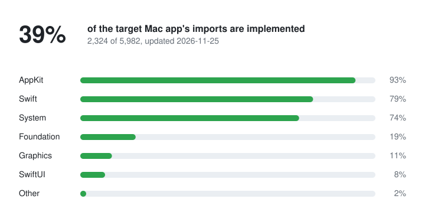

# bitten

Run macOS programs from a `.dmg` inside an ordinary Docker container on Linux.

No virtual machine, no macOS installation and no borrowed compatibility
layer: bitten is its own Mach-O loader and its own implementation of the
macOS system interfaces, written from scratch on top of Linux.

```
docker build -t bitten .
docker run --rm -it -v /path/to/App.dmg:/dmg/app.dmg:ro bitten
```

That prints what is inside the image and how much of what each program needs
is implemented. You bring the `.dmg`; nothing from Apple or from any app is
in this repository or in the image.

## Progress



Redrawn after every change to `main` by `tools/progress-update.sh` (measured
with `mrun --check` on a local copy of App.dmg; only counts are published, on
the [`progress`](https://github.com/GhouI/bitten/tree/progress) branch).

## What works today

| Kind of program | Status |
| --- | --- |
| Command-line tools written in C against libSystem | Runs, within the implemented calls |
| Go programs for macOS, with or without cgo | Runs: scheduler, GC, signals, network poller, `os/exec`, ptys |
| Programs that execute raw `syscall` instructions | Runs for the BSD calls listed in `src/loader/rawsys.c` |
| Grand Central Dispatch (queues, groups, semaphores, sources) | Runs, including dispatch objects under ARC |
| CommonCrypto, zlib, libcompression, iconv | Runs: SHA/MD5/HMAC, AES, PBKDF2, inflate/deflate, LZ4, LZFSE, LZVN |
| Objective-C (runtime, ARC, blocks, NSInvocation) | Runs: messaging, categories, protocols, weak references, forwarding |
| Foundation | Mostly runs: collections, strings, data, dates, formatters, files, URLs, JSON and property lists, run loops, timers, KVC/KVO, archiving, tasks and pipes, XPC (within the process), Apple events and Cocoa scripting, URLSession over libcurl (HTTP/1.1, HTTP/2, TLS, WebSockets) |
| Swift programs | Runs: bitten has its own Swift runtime (metadata, generics, existentials, parameter packs, concurrency, key paths, reflection) and its own Swift standard library build, plus Foundation, Combine, Observation, RegexBuilder, CryptoKit, Network and other overlays |
| AppKit | Partial but large: windows, views, controls, text, menus, toolbars, popovers, alerts, open/save panels, split views, drag and drop, Auto Layout (a Cassowary solver), stack views, layers |
| SwiftUI | Partial: views, modifiers, state, environment, navigation, tables, charts; drawn through AppKit |
| CoreGraphics, CoreText, ImageIO | Runs for drawing, paths, gradients, text layout with real font files, PNG and JPEG |
| Windows on screen | A browser page served by `mrun` (default http://localhost:7681), or X11 windows; both accept mouse and keyboard input |
| Metal | A software device compiles supported Metal library shaders for x86-64 and rasterises draws on the CPU. It renders the target app's terminal frames |
| Asset catalogs | AppKit reads named bitmap images from `Assets.car`, including packed atlases. Vector renditions are not drawn |
| launchd | Emulated: `launchctl` bootstrap/bootout/kickstart/print/list work against a job table |
| Objective-C or C++ exceptions | Not yet: no unwinder for Mach-O unwind tables |
| arm64-only binaries | No: x86-64 slices only (universal binaries are fine) |
| APFS-formatted disk images | Not yet: HFS+ images only |

### The target app

The project's yardstick is a real terminal app shipped as a `.dmg` (called
`App.dmg`, "the target app", below). Its two programs stand like this:

| Program in the bundle | What it is | Status |
| --- | --- | --- |
| `Contents/Helpers/Server.app/Contents/MacOS/app-server` | The app's server and CLI (Go, cgo, SQLite) | **Runs unmodified.** Server, sessions, terminals, shells, `send`, `capture`, the control API |
| `Contents/MacOS/App` | The window: SwiftUI + AppKit + Metal | Opens onboarding, workspace and settings windows, starts its server through bitten's `launchctl` and connects to it. There are no missing required imports (80 unbound weak imports). A fresh home directory still exposes startup failures |

The app's terminal *engine* can also be used on its own, without the
window. Replace `appcli` with the bundled CLI's name:

```
APP_DMG=/path/to/App.dmg APPCLI=appcli docker compose -f examples/mac-terminal/compose.yaml up
# open http://localhost:7680
```

That page is a small viewer belonging to bitten: it shows the screen with
`appcli capture` and types with `appcli send` (`appcli` stands for the app's
command-line program), both served by the unmodified macOS binary.

### What is next

The software Metal device renders the shell prompt, typed text and output.
The terminal pane stays white because AppKit draws the view's sublayers
but skips its backing layer's own `contents`. The runtime Docker image
also lacks the shader compiler needed to produce those frames. See
[docs/NEXT.md](docs/NEXT.md) for these gaps and the first-launch failures.

## Using it

```
docker run --rm -it -v /path/App.dmg:/dmg/app.dmg:ro bitten [COMMAND]

  info                 what is in the image and what state each program is in (default)
  run [ARGS...]        run the app's main program
  exec NAME [ARGS...]  run another program from the bundle, such as a helper tool
  shell                a shell with every program in the bundle on PATH
  check NAME           list every import of NAME that is not implemented
```

Without `DISPLAY`, the container shows windows on a page at
http://localhost:7681 (add `-p 127.0.0.1:7681:7681`). With `DISPLAY` set,
the entrypoint selects `BITTEN_DISPLAY=x11` unless you selected another
back end. For a local X server (including Xwayland), pass in its socket
and a readable authority file:

```
docker run --rm -it -e DISPLAY -v /tmp/.X11-unix:/tmp/.X11-unix \
  -v "$XAUTHORITY":/tmp/.Xauthority:ro -e XAUTHORITY=/tmp/.Xauthority \
  -v /path/App.dmg:/dmg/app.dmg:ro bitten run
```

With Compose, from this directory:

```
DMG=/path/App.dmg docker compose run --rm app            # info
DMG=/path/App.dmg docker compose run --rm app exec appcli version
```

The container needs no extra privileges. It uses `prctl` for syscall user
dispatch (Linux 5.11 or newer) and `arch_prctl`, both allowed by Docker's
default seccomp profile.

Without Docker:

```
make                      # builds build/mrun and the frameworks (gcc, make, clang, lld, swiftc)
build/mrun path/to/macho-program args...
build/mrun --check path/to/macho-program     # what is missing (and unbound weak imports)
BITTEN_DISPLAY_PORT=7681 build/mrun App.app/Contents/MacOS/App   # windows at http://localhost:7681
BITTEN_DISPLAY=x11 build/mrun App.app/Contents/MacOS/App         # windows on the desktop ($DISPLAY)
tools/dmgx extract App.dmg outdir            # unpack a disk image
```

Outside the container, select X11 explicitly; `DISPLAY` alone does not
select it. X11 headers are optional at build time and `libX11.so.6` is
loaded at run time. If X11 cannot open, `mrun` uses the browser page.

## How it works

`mrun` is a normal Linux program. It maps the x86-64 slice of a Mach-O
executable into its own address space, applies the fixups dyld would apply,
and binds each imported macOS symbol to an implementation inside `mrun` that
speaks Darwin's ABI and is built on Linux and glibc. Where the two systems
disagree, bitten translates: structure layouts, flag and errno numbers,
signals and their saved contexts, thread-local storage through `%gs`,
kqueue on epoll, and raw Darwin system calls caught with syscall user
dispatch. A program that asks for something bitten lacks is told exactly
which symbol.

[docs/ARCHITECTURE.md](docs/ARCHITECTURE.md) explains each piece.

## Repository layout

```
src/loader/      Mach-O loader, export registry, raw-syscall dispatch, launchctl, entry point
src/libsystem/   libSystem: files, processes, threads, signals, sockets, kqueue, ttys, sysctl
src/frameworks/  C inside mrun: Objective-C and Blocks runtimes, the Swift runtime and
                 concurrency, CoreFoundation, CoreGraphics, CoreText, dispatch, Security,
                 compression, the display server, URL loading over libcurl
frameworks/      frameworks built as Mach-O: Foundation, AppKit, SwiftUI, Combine,
                 QuartzCore, Metal, Network, CryptoKit and others (Objective-C and Swift)
overlays/        Swift overlays (Darwin, Dispatch, CoreGraphics, ObjectiveC, os, ...)
stdlib/          building the Swift standard library for bitten
sdk/include/     bitten's own headers and module maps
src/include/     shared headers (Mach-O format, Darwin ABI layouts)
tools/           dmgx (.dmg extractor), code generators, the progress chart
docker/          container entrypoint and macOS-style login
examples/mac-terminal/    Compose file and terminal viewer for the target app
tests/           Mach-O tests: c, objc, foundation, appkit, swift, swiftlib, go, media, ...
docs/            architecture, target app analysis, decisions, work log
```

## Tests

```
make check        # Mach-O tests; needs clang, lld and swiftc; Go tests need Go
make check-dmgx   # disk-image reader
docker build --target test .   # everything, in a clean container
```

With a local image built as `bitten`, set `APP_DMG` to your disk image and
`APPCLI` to the bundled CLI's name. Then `tests/e2e/target-app.sh` checks
the server and CLI in a container, down to a command typed into bitten's
terminal viewer. It does not exercise the app's own window.

A GitHub Actions workflow that builds the test and runtime images is in
`ci/github-actions.yml`; copy it to `.github/workflows/ci.yml` to switch it
on.

The tests are real Mach-O programs. C tests are compiled for
`x86_64-apple-macos` against hand-written declarations and linked with LLVM's
`ld64.lld` against a stub libSystem generated from bitten's own symbol list,
so no Apple SDK is involved. Go tests come from the Go toolchain's own macOS
linker.

## Scope and limits

- Linux x86-64 hosts and x86-64 Mach-O code only. There is no CPU emulation.
- The macOS version reported to programs is 15.0.
- Programs are not sandboxed from the container: a Mach-O program can do
  whatever a Linux program in the same container could.
- You are responsible for having the right to run the software you mount.

## Documentation

- [docs/ARCHITECTURE.md](docs/ARCHITECTURE.md): design of the loader and the layer
- [docs/NEXT.md](docs/NEXT.md): current state and exactly what to do next
- [docs/ROADMAP.md](docs/ROADMAP.md): the layers still to build, in order
- [docs/TARGET-APP.md](docs/TARGET-APP.md): what the target app imports, what is covered, what remains
- [docs/DECISIONS.md](docs/DECISIONS.md): choices made, and approaches that were dropped
- [docs/DMG-FORMAT.md](docs/DMG-FORMAT.md): disk-image support
- [docs/LOG.md](docs/LOG.md): running work log

## License

MIT, see [LICENSE](LICENSE). bitten contains no Apple code. Format and
interface knowledge comes from public documentation and from observing
programs run. In a few places published open-source material was read as a
reference for behaviour, not copied: Apple's open-source libproc wrapper for
return-value conventions, the LZFSE reference implementation, and the HFS+
technical note and decmpfs layouts cited in
[docs/DMG-FORMAT.md](docs/DMG-FORMAT.md).
